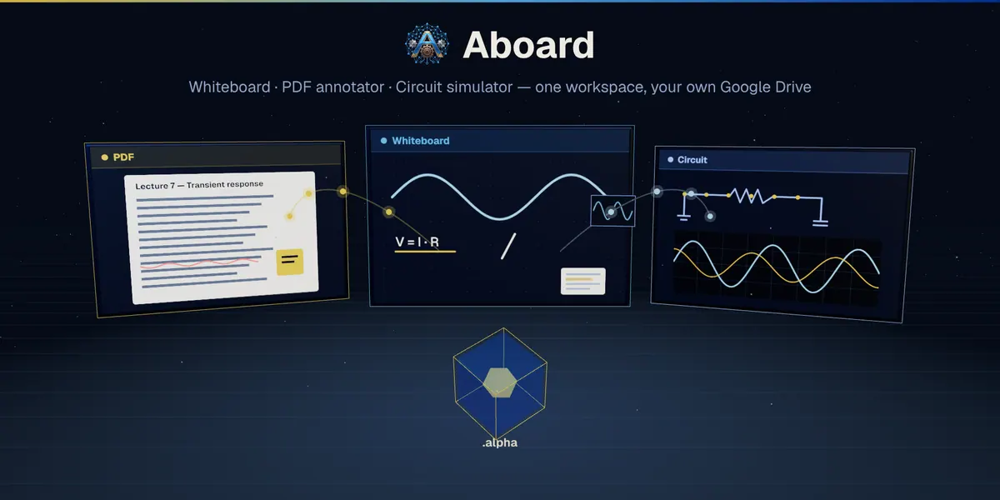
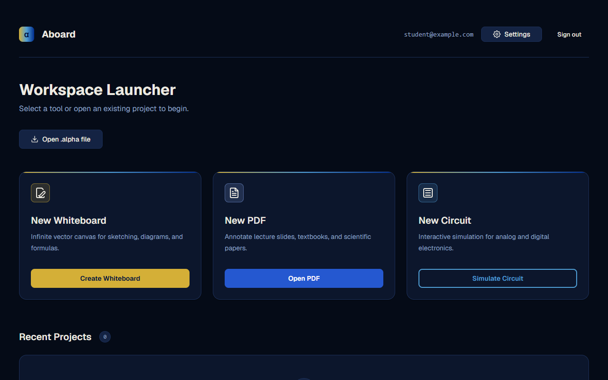
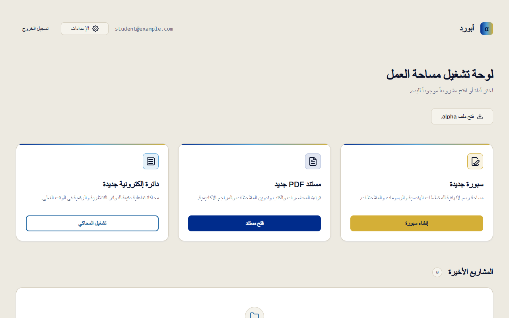
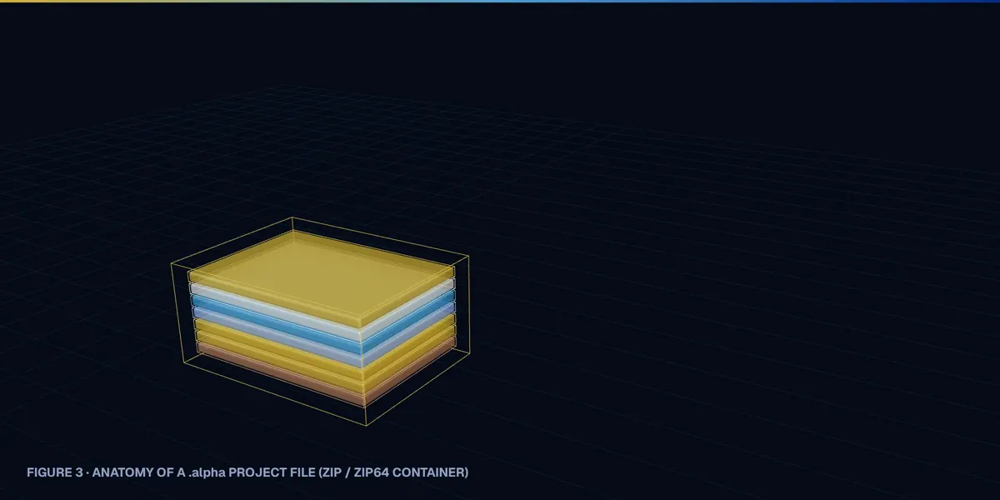

<div align="center">

<a href="https://alpha-board-app.vercel.app"></a>

<br/>

<a href="https://alpha-board-app.vercel.app"></a>
<a href="https://github.com/M01stafa/aboard/actions/workflows/ci.yml"></a>


<b><a href="https://alpha-board-app.vercel.app">Open the app</a></b> ·
<a href="docs/PRD.md">Requirements</a> ·
<a href="docs/specs/architecture.md">Architecture spec</a> ·
<a href="docs/specs/security.md">Security spec</a> ·
<a href="docs/DESIGN.md">Design system</a>

</div>

---

> **Abstract.** Engineering and medical students study with three separate kinds of software: a PDF reader for lecture material, a whiteboard for derivations and diagrams, and a circuit simulator for assignments. Moving content between them means screenshots, and all-in-one alternatives keep the student's files on the vendor's servers. **Aboard** ("Alpha board") integrates three established open-source engines (Excalidraw, EmbedPDF/PDFium and CircuitJS1) into one browser workspace with tabs, a split view and direct cross-tool actions. Its storage model is the main design choice: content lives in the student's own Google Drive or only in their browser, the server keeps accounts and a small project index, and a whole project exports to one portable `.alpha` file. Release R1 is in production with 473 unit tests, 26 end-to-end specifications and a database isolation test suite that runs in continuous integration.

## Contents

1. [Problem and objectives](#1-problem-and-objectives)
2. [System overview](#2-system-overview)
3. [Architecture](#3-architecture)
4. [Persistence and synchronisation](#4-persistence-and-synchronisation)
5. [The `.alpha` project format](#5-the-alpha-project-format)
6. [Security and privacy model](#6-security-and-privacy-model)
7. [Verification](#7-verification)
8. [Interface, accessibility and internationalisation](#8-interface-accessibility-and-internationalisation)
9. [Repository structure](#9-repository-structure)
10. [Running locally](#10-running-locally)
11. [Limitations and future work](#11-limitations-and-future-work)
12. [Third-party components and licences](#12-third-party-components-and-licences)
13. [Citation and author](#13-citation-and-author)

## 1. Problem and objectives

| | |
|:--|:--|
| **Problem** | Study material is spread across disconnected tools; content moves between them only as screenshots; integrated products store user files on vendor servers, with cost, privacy and lock-in consequences. |
| **O1 · Integration** | Whiteboard, PDF and circuit tools run together without losing state when the user switches tabs or changes the layout. |
| **O2 · Interoperability** | Cross-tool actions that save time: a PDF page or a circuit becomes an editable object on a board. |
| **O3 · Data ownership** | Content stays in the user's Google Drive or browser and can always be exported as one `.alpha` file. |
| **O4 · Constant cost** | Server cost does not grow with the number or size of user files. |
| **O5 · Language** | Arabic (right-to-left) and English interfaces with equal priority. |

**Non-goals for R1:** offline mode, real-time collaboration, native apps, and storing user files on Aboard servers. Aboard integrates existing engines and does not re-implement them.

## 2. System overview

<p align="center">
  
  
</p>
<p align="center"><sub><b>Launcher</b> in English (dark theme) and Arabic (light theme, right-to-left).</sub></p>

| Module | Engine | Embedding | Persisted as |
|:--|:--|:--|:--|
| **Whiteboard** | Excalidraw 0.18.1 (MIT) | React component | Elements and view state (JSON); images as content-addressed files |
| **PDF reader / annotator** | EmbedPDF on PDFium WASM (MIT), `@cantoo/pdf-lib` | React component; WASM self-hosted | Original PDF stored once by SHA-256 hash; annotations as separate JSON linked to that hash |
| **Circuit simulator** | Fork of `pfalstad/circuitjs1` (GPL-2.0-or-later), GWT | Same-origin iframe (`/circuit/`) with a typed adapter | CircuitJS1 text format |

**Cross-tool actions.** A PDF page, including its annotations, becomes a locked image on a board that the user can draw over (INT-1). A circuit becomes an image on a board (INT-2). A board is appended to a PDF as a new page (INT-3). Selected PDF text becomes a board note with a link back to its page (INT-4). The target board is chosen automatically: the other visible pane, otherwise the most recent board, otherwise a new one.

## 3. Architecture

<picture>
  <source media="(prefers-color-scheme: light)" srcset="docs/readme/architecture-light.svg" />
  <source media="(prefers-color-scheme: dark)" srcset="docs/readme/architecture.svg" />
  
</picture>

The application is a client-side Next.js app. User content never passes through the Next.js server: there are no Server Actions or Route Handlers for boards, circuits, PDFs or Drive files. The main architectural decisions (full list in [`docs/specs/architecture.md`](docs/specs/architecture.md) §3):

| ID | Decision | Rationale |
|:--|:--|:--|
| ADR-2 | Each tool is a module behind a typed adapter; no code merging between engines | Three toolchains (TypeScript/React, Java/GWT, WASM) stay independent and upgradeable |
| ADR-4 | CircuitJS1 runs in a same-origin iframe built from a published fork | GWT owns its DOM; clean isolation and a clear GPL boundary |
| ADR-7 | Storage behind a `StorageProvider` interface (`LocalProvider`, `DriveProvider`) | Modules never know where data lives; new providers plug in without touching them |
| ADR-8 | Google OAuth scope `drive.file` only | The app sees only files it created or the user picked |
| ADR-10 | Every save goes to IndexedDB first, then to Drive through an outbox | A dropped connection or closed tab does not lose work |
| ADR-11 | Large files are content-addressed (SHA-256) | Deduplication, integrity checks, re-linking a PDF on another device |
| ADR-15 | One local database per user (`aboard:<userId>`) | IndexedDB is per browser profile, not per account |

**Keep-alive workspace.** Moving an `<iframe>` or re-keying a React subtree reloads it, which would reset a running simulation or a PDF position. Every open tab is therefore rendered once, in a stable DOM order, and the layout is pure CSS grid: a pane is assigned to a `primary`, `secondary` or `hidden` slot and hidden panes use `visibility: hidden` (never `display: none`, which gives canvases a zero size). An automated mount-counter test asserts that no module remounts across tab switches, split changes and pane swaps.

## 4. Persistence and synchronisation

<picture>
  <source media="(prefers-color-scheme: light)" srcset="docs/readme/write-path-light.svg" />
  <source media="(prefers-color-scheme: dark)" srcset="docs/readme/write-path.svg" />
  
</picture>

| Aspect | Behaviour |
|:--|:--|
| **Storage modes** | *Local mode*: IndexedDB is the store and every row is pinned. *Drive mode*: Drive is the store and IndexedDB is a write buffer and cache; only clean, already-uploaded files can be evicted (least recently used). |
| **Write path** | Payload written to IndexedDB (debounced 500 ms) → outbox entry per item (latest payload wins) → upload after 3 s of inactivity, at most every 30 s during continuous editing. Files upload before the items that reference them. |
| **Uploads** | Multipart below 5 MB; resumable in 8 MiB chunks above. Identical files are stored once (content hash). |
| **Failure handling** | Offline: pause and resume. HTTP 401: one token refresh. 429/5xx: up to five retries with jittered exponential back-off. Revoked access: "Reconnect Google Drive" banner while local saving continues. Drive full: banner plus `.alpha` export shortcut. |
| **Conflicts** | Boards are merged element by element (Excalidraw `reconcileElements`). Circuits and annotations keep both versions as a dated *conflict copy*. Files never conflict because they are immutable and content-addressed. |
| **Project index** | Supabase holds only titles, storage mode and Drive folder IDs, so projects are listed on every device; local projects from another device are shown with the hint to open a `.alpha` file. |

## 5. The `.alpha` project format



A project exports to a single file that opens on any device. The format follows the same idea as EPUB and ODF ([`docs/specs/alpha-format.md`](docs/specs/alpha-format.md)):

- **Container:** ZIP (ZIP64 when needed) written and read with `zip.js`. The first entry, `mimetype`, is stored uncompressed and contains `application/x-alpha-project`, so the type is recognisable from the first bytes.
- **Manifest:** a versioned schema (`formatVersion`) validated with `zod` on import; newer files produce an "update the app" message, and every schema change ships with a migration function.
- **Integrity:** each file carries its SHA-256 hash and is re-verified on import.
- **Import safety:** at most 5,000 entries, 2 GB uncompressed in total and 500 MB per entry; a 100:1 compression-ratio guard against ZIP bombs; rejection of absolute or `..` paths; `javascript:` and `data:` links stripped from boards; atomic rollback, so a rejected file leaves no partial project.
- **Scale:** streaming export to disk on Chromium desktop with flat memory use (500 MB verified); an in-memory fallback elsewhere, capped at 300 MB on mobile and 1 GB on desktop.

## 6. Security and privacy model

The central requirement is that **user A can never reach user B's data** ([`docs/specs/security.md`](docs/specs/security.md)).

| Threat | Control |
|:--|:--|
| Cross-user database access | Row-level security on every table, least-privilege grants, no access for the anonymous role; a pgTAP suite and a CI guard that fails if any table lacks RLS (SEC-1) |
| Theft of Google credentials | Client secret and refresh tokens exist only in Supabase Edge Functions; refresh tokens encrypted at rest with AES-256-GCM; access tokens held in memory only, never in `localStorage` or IndexedDB (SEC-2, verified by an automated check) |
| Over-broad Drive access | Scope `drive.file`: only files the app created or the user picked (SEC-3) |
| Shared computers | Per-user local databases and a "shared computer" option that wipes local data on sign-out (SEC-4) |
| Leaked keys | No secret in the bundle or repository; gitleaks and bundle scanning in CI; public keys restricted by API and referrer; rehearsed key-rotation runbook (SEC-5) |
| Abuse of endpoints | Authenticated, `zod`-validated, size- and rate-limited Edge Functions (HTTP 429), exact-origin CORS, strict Content-Security-Policy and security headers (SEC-6) |
| Malicious files | Imported content treated as data, never code; circuit SVG converted to an image instead of being inlined into the page (SEC-7) |
| Account takeover | Email one-time codes, Cloudflare Turnstile CAPTCHA, auth rate limits (SEC-9) |

Privacy: no file names, titles, Drive IDs or document content are sent to logs or analytics. Account deletion revokes the Google token and removes the account and project index; files in the user's Drive or browser stay with the user. The launch checklist (§14.12) was signed off before production.

## 7. Verification

| Layer | Tooling | Scope |
|:--|:--|:--|
| Unit | Vitest | 473 tests in 54 files at R1 sign-off: storage providers, SaveQueue, `.alpha` engine, adapters, workspace mount counter |
| End-to-end | Playwright | 26 specifications: persistence, cross-tool actions, PDF annotations and export, Drive errors, offline save status, shared-computer isolation |
| Database | pgTAP | Row-level-security isolation suite and an RLS guard over all public tables |
| Supply chain | `pnpm ci:security` | gitleaks secret scan, bundle secret grep, dependency audit |

Every push to `main` runs lint (ESLint plus an 8-point spacing check), type checking, unit tests, the pgTAP suite against a local Supabase stack, the RLS guard and the security checks ([`.github/workflows/ci.yml`](.github/workflows/ci.yml)). Development followed eleven phases, each closed only when its acceptance criteria passed; five technical spikes (S1–S5) validated the riskiest integrations first. Records: [`docs/PROGRESS.md`](docs/PROGRESS.md) and [`docs/spikes/`](docs/spikes/).

## 8. Interface, accessibility and internationalisation

- **Design system:** the Alpha brand tokens in [`docs/DESIGN.md`](docs/DESIGN.md): royal blue, ivory, gold and tech blue; Geist (Latin) and Alexandria (Arabic) variable fonts, self-hosted; an 8-point spacing grid; light and dark themes.
- **Right-to-left:** logical CSS properties throughout; the language switch flips `dir` without losing state; Excalidraw runs in `ar-SA` for Arabic.
- **Accessibility:** the application shell targets WCAG 2.2 AA, with every colour pair's contrast ratio computed and recorded in the design system; embedded tools follow their upstream accessibility.

## 9. Repository structure

```text
apps/web/app/          Next.js routes only (thin)
apps/web/src/          framework-free code
  workspace/           tabs, split view, keep-alive host
  modules/             board · pdf · circuit adapters and panes
  integration/         cross-tool actions (INT-1…4)
  core/                storage (ProjectService, providers, SaveQueue) · drive · alpha · bus
  theme/ i18n/         design tokens, fonts, Arabic/English strings
apps/web/public/       circuit/ (built fork output), wasm/, fonts/
supabase/              migrations/, tests/ (pgTAP), functions/ (6 Edge Functions)
vendor/circuitjs1/     CircuitJS1 fork (git submodule) + PATCHES.md
docs/                  PRD.md, specs/, PROGRESS.md, DESIGN.md, spikes/
```

## 10. Running locally

Requirements: Node.js 22, pnpm, the Supabase CLI and Docker. Rebuilding the circuit fork also needs OpenJDK 11 and Gradle 8.7; the built output is already in `apps/web/public/circuit/`.

```bash
git clone --recurse-submodules https://github.com/M01stafa/aboard.git
cd aboard
pnpm install
cp apps/web/.env.example apps/web/.env.local   # fill in Supabase, Google and Turnstile values
supabase start && supabase db reset   # local database with migrations
pnpm dev                              # http://localhost:3000
```

Checks: `pnpm lint && pnpm typecheck && pnpm test && supabase test db && pnpm ci:security`. Production setup (Google Cloud, Supabase, Vercel): [`docs/DEPLOYMENT.md`](docs/DEPLOYMENT.md).

## 11. Limitations and future work

- **Known issue:** in left-to-right layouts the split-view divider moves in the opposite direction to the drag.
- **By design:** no offline mode and no in-app real-time collaboration; projects are shared as `.alpha` files or Drive links.
- **Not yet measured:** the performance targets in the PRD (workspace interactive within 3 s, first page of a 50 MB PDF within 5 s) are design targets and still need measurement with real users.
- **Planned:** keyboard shortcuts for tabs and split view, project search and duplication, and Arabic strings inside the circuit engine's native menus (the custom circuit toolbar is already bilingual).

## 12. Third-party components and licences

| Component | Licence | Use |
|:--|:--|:--|
| [Excalidraw](https://github.com/excalidraw/excalidraw) | MIT | Whiteboard engine |
| [CircuitJS1](https://github.com/pfalstad/circuitjs1) ([Aboard fork](https://github.com/M01stafa/circuitjs1)) | GPL-2.0-or-later | Circuit simulation engine |
| [EmbedPDF](https://github.com/embedpdf/embed-pdf-viewer) | MIT | PDF rendering (PDFium WASM) and annotation |
| [PDFium](https://pdfium.googlesource.com/pdfium/) (bundled as WebAssembly) | Apache-2.0 | PDF engine inside EmbedPDF |
| `@cantoo/pdf-lib`, `hash-wasm`, `zustand`, `mitt`, `supabase-js` | MIT | PDF editing, hashing, state, events, backend client |
| `@zip.js/zip.js` | BSD-3-Clause | `.alpha` container |
| `dexie` | Apache-2.0 | IndexedDB |
| Geist, Alexandria | OFL-1.1 | Fonts |

The full notices are on the in-app [licences page](https://alpha-board-app.vercel.app/licenses).

## 13. Citation and author

**Mustafa Chyad**, founder of Alpha Group · [LinkedIn](https://www.linkedin.com/in/mustafa-chyad) · [GitHub](https://github.com/M01stafa)

```bibtex
@software{chyad_aboard_2026,
  author = {Chyad, Mustafa},
  title  = {Aboard: an integrated whiteboard, PDF annotation and circuit simulation workspace with user-owned storage},
  year   = {2026},
  url    = {https://github.com/M01stafa/aboard},
  note   = {Release R1, Alpha Group}
}
```

<sub>Figures 1–2 are generated SVG diagrams. The header and Figure 3 are three.js scenes rendered frame by frame; their sources are in <a href="docs/readme/source/"><code>docs/readme/source/</code></a>. All visuals use the Alpha design-system tokens.</sub>
